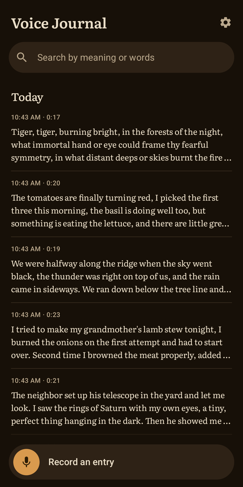

# Voice Journal

A fully offline voice journal for Android. Record your thoughts, get them transcribed on-device, and search them by meaning, not just keywords. Nothing ever leaves your phone — but nothing is trapped there either: export the whole journal (audio and transcripts) to a file anywhere you choose, optionally encrypted with a password, and import it back later, so your journal survives an uninstall or a new phone.

<p align="center">
  
</p>

## Why offline matters

A journal is one of the most private things a person owns. This app has **no INTERNET permission**. Not "we don't upload your data," but "the OS will not let this app touch the network." Check for yourself:

- Source: [`AndroidManifest.xml`](app/src/main/AndroidManifest.xml) declares `RECORD_AUDIO` plus local-only plumbing (foreground service types, wakelock, notifications) so recording survives the screen turning off and an interrupted entry can be recovered. No network permission of any kind
- Built APK: `aapt dump permissions <apk>` shows the same
- Enforced, not just declared: a library's manifest can add permissions behind the app's back (ONNX Runtime's does, along with a telemetry initializer). Those entries are stripped in the manifest, the Gradle build fails if the merged manifest contains a network permission (`verifyNoNetwork` in [`app/build.gradle.kts`](app/build.gradle.kts)), and CI checks the built APK again

Transcription runs locally through [whisper.cpp](https://github.com/ggerganov/whisper.cpp) (base.en, q5_1). Semantic search runs locally through [gte-base](https://huggingface.co/thenlper/gte-base) (int8 ONNX). Your recordings, transcripts, and embeddings live in app-private storage; the export/import feature copies a file to a location you pick, and only when you ask it to.

What protects the journal, precisely:

- **On the device:** Android's app sandbox and the device's own storage encryption. The app lock (biometric or screen-lock credential) and screenshot blocking keep someone holding the unlocked phone out; they are a screen gate, not encryption.
- **In an export:** nothing, unless you set a password. With one, the file is sealed with AES-256-GCM under a key derived from the password (PBKDF2-HMAC-SHA256, 600,000 iterations); the format is described in [`ArchiveCrypto.kt`](app/src/main/java/dev/zyriel/voicejournal/data/ArchiveCrypto.kt). There is no recovery for a forgotten password.

## Search

The search box combines two signals ([`Search.kt`](app/src/main/java/dev/zyriel/voicejournal/search/Search.kt)):

- **Meaning.** Each entry is embedded on-device, and a query finds entries by what they are about even when they never say the word: "physics" brings back a ramble about clocks on fast ships, "math" a proof talked through out loud. [`ConceptSearchTest`](app/src/test/java/dev/zyriel/voicejournal/search/ConceptSearchTest.kt) is the bar: 36 entries, 35 such queries, and the model was chosen on it (mean average precision 0.89, against 0.74 for the bge-small model used before). The kind of a recording is harder than its subject: "poems" leads with recited poems but also returns a prayer and a hymn, and misses the least poem-like ones. A query matches entries whose similarity clears a floor and sits close to the best match, both measured against the bundled model ([`SearchCalibrationTest`](app/src/test/java/dev/zyriel/voicejournal/search/SearchCalibrationTest.kt)). A query about something you never said usually returns nothing, instead of the twenty least-unrelated entries. This is a trim, not a guarantee: the model's similarity scores for related and unrelated text overlap, so a loosely related entry can still appear behind the real matches.
- **Words.** An entry that contains a query word is always a result and gets a ranking boost, which is what finds names and other exact terms the model has no feel for. It is also how an entry is found before its embedding exists (just imported, just edited).

Entries longer than the model's 256-token window are embedded as overlapping windows, so the end of a ten-minute entry is as searchable as its first minute.

## Performance

Measured on a Pixel 11 Pro XL (Android 17) running build `cd7b539` (version 1.1.0) with the dotprod native library. Raw data: [`vj-benchmark-cd7b539.json`](docs/benchmarks/vj-benchmark-cd7b539.json) and [`vj-accuracy-cd7b539.json`](docs/benchmarks/vj-accuracy-cd7b539.json).

Transcription of real speech (LibriSpeech clips), median of three runs after a warm-up:

| Clip | VAD off | VAD on (default) |
|---|---|---|
| 10 s of speech | 2.56 s | 2.63 s |
| 30 s of speech | 2.95 s | 3.04 s |
| 60 s of speech | 9.04 s | 6.50 s |
| 80 s, half of it pauses | 10.64 s | 6.96 s |

So a one-minute entry takes about 6.5 seconds to become searchable text with the default settings.

| Operation | Median of 5 | Notes |
|---|---|---|
| Embed a typical entry (163 chars) | 15 ms | gte-base, int8 |
| Embed a long entry (4,310 chars) | 315 ms | several overlapping windows |
| Semantic search, 5,000 entries | 15 ms | brute-force cosine, top 20, 768-dim vectors |

The benchmark file also has `whisper.clip10s/30s/60s` rows. Those are a synthetic 220 Hz tone, not speech: with VAD off they take 2.69, 5.68 and 9.36 s, and with VAD on the tone is skipped as non-speech in well under a second. They are useful for comparing builds and are not quoted as performance.

Accuracy: **4.05% word error rate with VAD on, 5.41% with VAD off**, on a LibriSpeech test-clean subset of 3 clips, 3 speakers, 7 utterances and 222 reference words (9 and 12 errors). That is a small sample: the 95% interval for 9 errors in 222 words is roughly 2.2% to 7.5%, so treat the figure as a sanity check, not a model comparison. There were zero deletions in every clip, so the VAD trim did not eat words. Scoring uses a plain normalizer (lowercase, punctuation stripped, curly apostrophes folded, a small British-to-American spelling map), stricter than Whisper's own `EnglishTextNormalizer`. Per-clip numbers, including the raw hypotheses, are in the accuracy JSON. Growing the set to a few hundred utterances needs a device run; [`scripts/build-accuracy-set.py`](scripts/build-accuracy-set.py) builds the clips and manifest from a LibriSpeech download.

Voice activity detection (silero v5.1.2) is on by default. On the committed clips it lowered WER from 5.41% to 4.05%: two fewer errors on the 60 s clip and one fewer on the 10 s clip. On continuous speech it costs about 3% in latency (the 10 s and 30 s clips), and it is faster wherever there are pauses to skip. The `acc.speech_gaps` rows measure that on real speech: two clips, each followed by room-tone silence of its own length. With VAD on, no words are lost and WER is 3.7%; with VAD off, whisper invents 21 words in the trailing silence (22.4% WER) and takes half as long again.

Search stays instant at journal scale, which is why there is no vector database in this app.

## Building

Requirements:

- Android Studio (latest stable), or a JDK 21 and the command-line SDK
- Via SDK Manager: Android SDK Platform 36, NDK **28.2.13676358** (exact, pinned for 16 KB page alignment), CMake 3.22.1

The model files are not tracked in git. Fetch them once before the first build; both scripts download the same four files from pinned revisions and verify each one against [`scripts/models.sha256`](scripts/models.sha256).

On Windows:

```powershell
powershell scripts\fetch-models.ps1
gradlew.bat assembleDebug
```

On Linux or macOS:

```bash
bash scripts/fetch-models.sh
./gradlew assembleDebug
```

Or open the project root in Android Studio and build. Unit tests run with `./gradlew testDebugUnitTest`; the wall-clock checks in `BenchTest` are off by default and run with `-Pvj.perfAssertions=true`.

### Reproducing a release

Release builds use exactly the toolchain pinned in the repo: AGP 9.2.1, Gradle 9.6.0 (wrapper), Kotlin 2.2.10, JDK 21, NDK 28.2.13676358, CMake 3.22.1, with the models fixed by `scripts/models.sha256`. CI builds an unsigned release APK and AAB on every push and keeps them as workflow artifacts. Each tagged release (`v1.0.0` onward) is the corresponding source for the APK built from it. Release APKs on GitHub are signed with the certificate whose SHA-256 is `e6be235505cece28cfc87abc5508469efa0da1295e253d8e70f8f35cc428eee5`; check a download with `apksigner verify --print-certs`. To get updates automatically, add this repository to [Obtainium](https://github.com/ImranR98/Obtainium).

## Stack

Kotlin, Jetpack Compose, Room. Native transcription via whisper.cpp over JNI (arm64); the vendored copy is trimmed to what the build uses, see [`VENDORED.md`](app/src/main/cpp/VENDORED.md). Embeddings via ONNX Runtime. JVM unit tests cover the recording state machine against fakes, the archive and its encryption, crash recovery, and real ONNX inference against the bundled model.

## License

Copyright (C) 2026 ZyrielZero. GPLv3. See [LICENSE](LICENSE) and [THIRD_PARTY_NOTICES.md](THIRD_PARTY_NOTICES.md).

The GPL covers this project's own code (the Kotlin app, the JNI bridge and the build scripts) and the app as a whole as distributed. The components it bundles keep their own licenses: whisper.cpp and ggml, ONNX Runtime and the three models are MIT, the AndroidX and Kotlin libraries are Apache 2.0, and the Literata font is under the SIL Open Font License. All of them are compatible with GPLv3, and their license texts ship inside the app (About, then View license or Third-party notices). The LibriSpeech clips used by the accuracy benchmark are CC BY 4.0 and are only in debug builds.

The app is free software. A paid, identical build will be available on Google Play for people who prefer to install it that way and support development.
