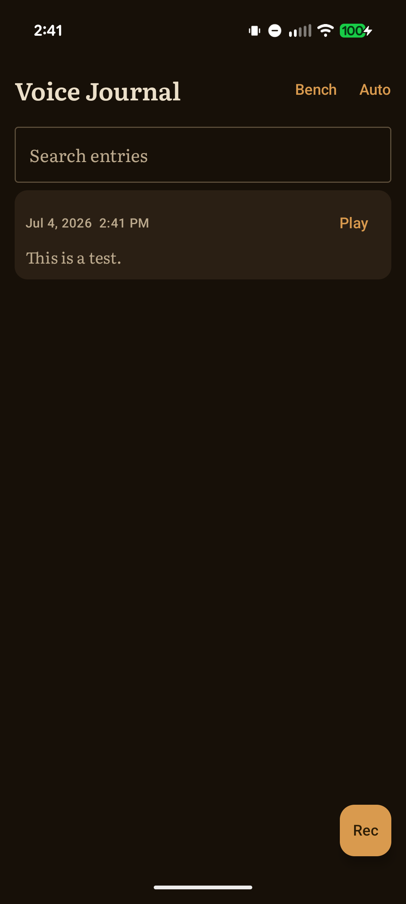

# Voice Journal

A fully offline voice journal for Android. Record your thoughts, get them transcribed on-device, and search them by meaning, not just keywords. Nothing ever leaves your phone — but nothing is trapped there either: export the whole journal (audio and transcripts) to a zip anywhere you choose, and import it back later, so your journal survives an uninstall or a new phone.

<p align="center">
  
</p>

## Why offline matters

A journal is one of the most private things a person owns. This app has **no INTERNET permission**. Not "we don't upload your data," but "the OS will not let this app touch the network." Check for yourself:

- Source: [`AndroidManifest.xml`](app/src/main/AndroidManifest.xml) declares `RECORD_AUDIO` plus local-only plumbing (foreground service, wakelock, notifications) so recording survives the screen turning off. No network permission of any kind
- Built APK: `aapt dump permissions <apk>` shows the same

Transcription runs locally through [whisper.cpp](https://github.com/ggerganov/whisper.cpp) (base.en, q5_1). Semantic search runs locally through [bge-small-en-v1.5](https://huggingface.co/BAAI/bge-small-en-v1.5) (int8 ONNX). Your recordings, transcripts, and embeddings live in app-private storage; the export/import feature copies a zip to a location you pick, and only when you ask it to.

## Performance

Measured on a Pixel 10 Pro XL running build `ce5f560` (version 0.4.1). Raw data: [`vj-benchmark-ce5f560.json`](docs/benchmarks/vj-benchmark-ce5f560.json) and [`vj-accuracy-ce5f560.json`](docs/benchmarks/vj-accuracy-ce5f560.json).

Transcription of real speech (LibriSpeech clips), single runs:

| Clip | VAD off | VAD on (default) |
|---|---|---|
| 30 s of speech | 2.78 s | 4.57 s |
| 60 s of speech | 6.19 s | 9.28 s |

So a one-minute entry takes about 9 seconds to become searchable text with the default settings. The 10 s clip is left out because its rows include model and VAD start-up. Each figure is one run, not a median; the bench now does a warm-up and three timed runs per row, and the table will be refreshed from the next device run.

| Operation | Median of 5 | Notes |
|---|---|---|
| Embed a typical entry (163 chars) | 8 ms | |
| Semantic search, 5,000 entries | 10 ms | brute-force cosine, top 20 |

The benchmark file also has `whisper.clip10s/30s/60s` rows (1.51, 1.68 and 3.37 s). Those are a synthetic 220 Hz tone with VAD off, not speech; they are useful for comparing builds but understate real latency by about 1.7x to 1.8x, so they are not quoted as performance.

Accuracy: **4.50% word error rate with VAD on, 6.31% with VAD off**, on a LibriSpeech test-clean subset of 3 clips, 3 speakers, 7 utterances and 222 reference words (10 and 14 errors). That is a small sample: the 95% interval for 10 errors in 222 words is roughly 2.5% to 8.1%, so treat the figure as a sanity check, not a model comparison. There were zero deletions in every clip, so the VAD trim did not eat words. Scoring uses a plain normalizer (lowercase, punctuation stripped, curly apostrophes folded, a small British-to-American spelling map), stricter than Whisper's own `EnglishTextNormalizer`. Re-scoring the committed transcripts with the current normalizer gives 4.05% (9 errors) and 5.86% (13 errors); the difference is "grey" against GRAY. Per-clip numbers, including the raw hypotheses, are in the accuracy JSON. Growing the set to a few hundred utterances needs a device run; [`scripts/build-accuracy-set.py`](scripts/build-accuracy-set.py) builds the clips and manifest from a LibriSpeech download.

Voice activity detection (silero v5.1.2) is on by default. On the committed clips it lowered WER from 6.31% to 4.50%; the whole difference is the 60 s clip (9 errors without VAD, 5 with, including a hallucinated trailing word). It costs about 1.5x to 1.7x in latency on continuous speech. The earlier "10.9 s to 2.3 s" result came from a synthetic tone with silent gaps, which silero may not treat as speech at all, so it is not a real-speech number. The bench now measures the same comparison on LibriSpeech speech with inserted pauses (`acc.speech_gaps` rows); that number is pending a device run.

Search stays instant at journal scale, which is why there is no vector database in this app.

## Building

Requirements:

- Android Studio (latest stable), or a JDK 21 and the command-line SDK
- Via SDK Manager: Android SDK Platform 36, NDK **28.2.13676358** (exact, pinned for 16 KB page alignment), CMake 3.22.1

The model files are not tracked in git. Fetch them once before the first build; both scripts download the same four files from pinned revisions and verify each one against [`scripts/models.sha256`](scripts/models.sha256).

On Windows:

```powershell
powershell scripts\fetch-models.ps1
gradlew.bat assembleDebug
```

On Linux or macOS:

```bash
bash scripts/fetch-models.sh
./gradlew assembleDebug
```

Or open the project root in Android Studio and build. Unit tests run with `./gradlew testDebugUnitTest`; the wall-clock checks in `BenchTest` are off by default and run with `-Pvj.perfAssertions=true`.

### Reproducing a release

Release builds use exactly the toolchain pinned in the repo: AGP 9.2.1, Gradle 9.6.0 (wrapper), Kotlin 2.2.10, JDK 21, NDK 28.2.13676358, CMake 3.22.1, with the models fixed by `scripts/models.sha256`. CI builds an unsigned release APK and AAB on every push and keeps them as workflow artifacts. Each tagged release (`v1.0.0` onward) is the corresponding source for the APK built from it. Release APKs on GitHub are signed with the certificate whose SHA-256 is `e6be235505cece28cfc87abc5508469efa0da1295e253d8e70f8f35cc428eee5`; check a download with `apksigner verify --print-certs`. To get updates automatically, add this repository to [Obtainium](https://github.com/ImranR98/Obtainium).

## Stack

Kotlin, Jetpack Compose, Room. Native transcription via whisper.cpp over JNI (arm64). Embeddings via ONNX Runtime. JVM unit tests, including real ONNX inference against the bundled model.

## License

Copyright (C) 2026 ZyrielZero. GPLv3. See [LICENSE](LICENSE) and [THIRD_PARTY_NOTICES.md](THIRD_PARTY_NOTICES.md).

The GPL covers this project's own code (the Kotlin app, the JNI bridge and the build scripts) and the app as a whole as distributed. The components it bundles keep their own licenses: whisper.cpp and ggml, ONNX Runtime and the three models are MIT, the AndroidX and Kotlin libraries are Apache 2.0, and the Literata font is under the SIL Open Font License. All of them are compatible with GPLv3, and their license texts ship inside the app (About, then View license or Third-party notices). The LibriSpeech clips used by the accuracy benchmark are CC BY 4.0 and are only in debug builds.

The app is free software. A paid, identical build will be available on Google Play for people who prefer to install it that way and support development.
